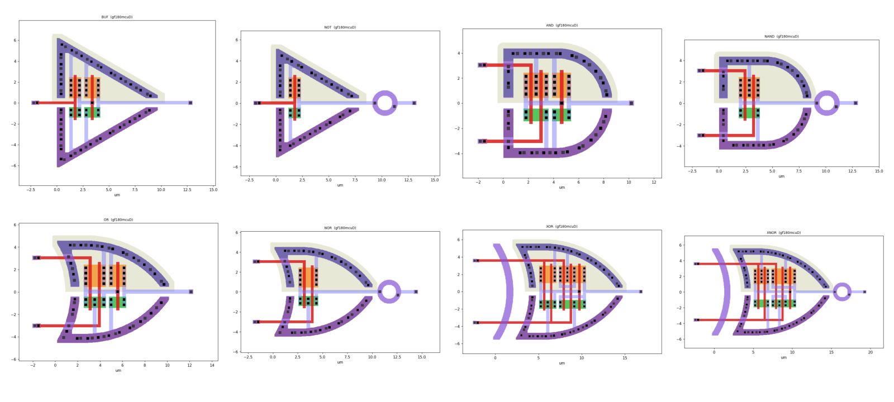
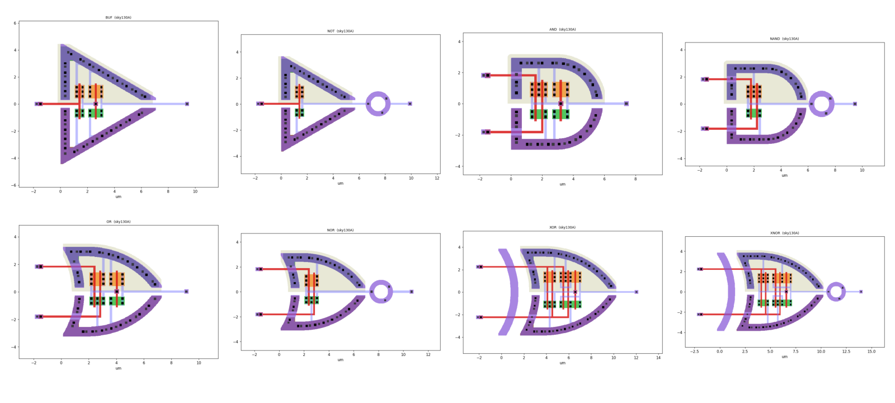

# EG-LOGIC (Magic VLSI)
CMOS logic gates whose layouts are drawn as their ANSI / IEEE 91 distinctive-shape symbols.
The cells are BUF, NOT, AND, NAND, OR, NOR, XOR and XNOR, made in Magic for the GlobalFoundries
GF180MCU (`gf180mcuD`) and SkyWater SKY130 (`sky130A`) PDKs. This is a follow-on to the BJT
symbol layouts [EG-1022N](https://github.com/ellisgl/EG-1022N) and
[EG-1022P](https://github.com/ellisgl/EG-1022P).

**GF180MCU**


**SKY130**


Preview colours: tan = N-well, orange = P-diffusion, green = N-diffusion, red = poly,
blue = R1, purple = R2, black = contacts, grey = vias.

## Structure
Each symbol stroke is a working part of the circuit:

| Symbol stroke | Layout |
|---|---|
| Body outline | Supply rail and guard ring: tap diffusion + R1 + R2 stacked in one band, with contacts and vias along it. The top half is an N-tap in the N-well (VDD) and the bottom half is a P-tap (VSS). |
| Top / bottom half of the body | The N-well fills the top half of the shape. PMOS sits there and NMOS below it. |
| Input lines | Poly. Each line passes under the outline and turns straight into its transistor gates. A enters along the top, B along the bottom, and single inputs on the centre line. |
| Output line | R1 on the centre line, leaving through the tip of the symbol |
| Bubble | R1 + R2 ring on the output net |
| XOR's extra back arc | R1 + R2 arc, electrically floating |

The two routing layers are named by role:

| | GF180MCU | SKY130 |
|---|---|---|
| R1 (local routing, on diff/poly contacts) | metal1 | li1 |
| R2 (outline, pins) | metal2 | met1 |

Pins are on R2: `A`, `B`, `Y`, `VDD` (on the top half of the outline) and `VSS` (on the bottom
half). Wells and substrate are tied inside the cell, so there are no separate body pins.

The curves are fine staircases on the 5 nm grid. Each symbol is scaled to the smallest height
that fits its transistors, so the cells are not all the same size. They are standalone cells
for hand placement, not row-based standard cells.

### Circuits
Static CMOS throughout. Transistors are drawn with W/L of 1.0/0.28 (N) and 2.0/0.28 (P) um on
GF180MCU, using the 3.3 V `nfet_03v3` and `pfet_03v3` devices. On SKY130 they are 0.65/0.15 (N)
and 1.0/0.15 (P) um, using `nfet_01v8` and `pfet_01v8`.

| Cell | Circuit | Transistors |
|---|---|---|
| NOT | inverter | 2 |
| BUF | 2 inverters | 4 |
| NAND / NOR | NAND2 / NOR2 | 4 |
| AND / OR | NAND2 / NOR2 + inverter | 6 |
| XOR | AOI21(A, B, NOR2(A, B)) | 10 |
| XNOR | OAI21(A, B, NAND2(A, B)) | 10 |

Inside the body, signals flow left to right along the centre line, as in the symbol. Internal
nets reach the next stage's gate through a poly contact in the gap between the PMOS and NMOS
rows.

### Cell sizes (um, including leads and pins)
| | BUF | NOT | AND | NAND | OR | NOR | XOR | XNOR |
|---|---|---|---|---|---|---|---|---|
| GF180MCU | 18.8 x 15.8 | 18.8 x 13.7 | 15.9 x 11.9 | 18.3 x 11.9 | 17.8 x 12.3 | 20.0 x 12.2 | 23.0 x 14.3 | 25.4 x 14.3 |
| SKY130 | 14.8 x 12.3 | 15.3 x 10.7 | 12.8 x 9.1 | 14.7 x 9.1 | 14.5 x 9.7 | 16.0 x 9.4 | 17.8 x 10.9 | 19.7 x 10.9 |

## Verification
All 16 cells (8 per PDK):
- **Magic DRC** (`drc(full)`): 0 errors.
- **Netgen LVS** against a reference netlist generated from the cell definition: circuits
  match uniquely, with no property (W/L) errors.
- **ngspice** on the extracted netlist (with parasitic capacitance): full truth table, every
  single-input transition, typical corner, 10 fF load.

Not yet checked: the foundry KLayout DRC decks, density, and antenna rules.

### Simulated delays (ps, typical, 27 C, 10 fF load)
Worst case over all input transitions. tr / tf are the 10-90% output rise and fall times.

| GF180MCU, 3.3 V | tpLH | tpHL | tr | tf |
|---|---|---|---|---|
| BUF  | 122 | 124 | 128 | 108 |
| NOT  | 73  | 69  | 126 | 102 |
| AND  | 179 | 146 | 140 | 112 |
| NAND | 91  | 124 | 158 | 204 |
| OR   | 146 | 199 | 128 | 130 |
| NOR  | 157 | 89  | 272 | 136 |
| XOR  | 223 | 227 | 316 | 262 |
| XNOR | 215 | 227 | 358 | 268 |

| SKY130, 1.8 V | tpLH | tpHL | tr | tf |
|---|---|---|---|---|
| BUF  | 99  | 88  | 136 | 70  |
| NOT  | 82  | 52  | 142 | 68  |
| AND  | 119 | 102 | 136 | 70  |
| NAND | 91  | 80  | 156 | 118 |
| OR   | 106 | 145 | 136 | 84  |
| NOR  | 171 | 58  | 304 | 76  |
| XOR  | 193 | 157 | 314 | 128 |
| XNOR | 199 | 136 | 340 | 134 |

Series stacks are not upsized, so NOR's rising edge and NAND's falling edge are the slow ones.

## Files
- `gen/gen.py`: generator. Writes `<pdk>/<CELL>.mag`, the reference netlist and the preview image.
- `gen/rules.py`: design rules, Magic layer names and device sizes for each PDK
- `gen/cells.py`: the cell circuits (diffusion islands, gate order, gap tracks)
- `gen/gallery.py`: builds `docs/gallery_<pdk>.png`
- `<pdk>/<CELL>.mag`, `<pdk>/<CELL>.gds`: layout
- `<pdk>/<CELL>_lvs.spice` (LVS netlist), `<pdk>/<CELL>.spice` (with parasitic capacitors)
- `<pdk>/<CELL>_ref.spice`, `<pdk>/<CELL>_lvs.txt`: LVS reference and report
- `<pdk>/summary.txt`: DRC/LVS summary
- `scripts/drc_ext.tcl`: DRC, extraction and GDS output in Magic
- `scripts/drc_dump.tcl`, `scripts/drc_overlay.py`: plot DRC error boxes over a cell (debugging)
- `sim/run_sim.py`: ngspice testbenches; writes `sim/<pdk>_results.json`
- `run_all.sh`: the whole generate / DRC / extract / LVS flow
- `examples/adder4/`: a 4-bit ripple-carry adder built from these cells, for both PDKs. It is
  DRC/LVS clean and passes an exhaustive simulation; see its [README](examples/adder4/README.md).

## Rebuild
```sh
export PDK_ROOT=~/pdk
./run_all.sh                  # both PDKs, or: ./run_all.sh sky130A
python3 sim/run_sim.py        # needs ngspice
python3 gen/gallery.py
```
Python needs numpy, scipy and matplotlib.

To use a cell, open it in Magic with the PDK's rc file, e.g.
`magic -rcfile $PDK_ROOT/sky130A/libs.tech/magic/sky130A.magicrc sky130A/NAND.mag`.
To place it in another layout, add the cell directory to Magic's search path (`addpath`).

Simulating GF180 netlists: GF180's `nfet_03v3` and `pfet_03v3` are `.model` cards, so the
extracted `X` instances must be changed to `M`. `sim/run_sim.py` does this.

## License
Copyright © 2026 Kenneth McCall (Ellis GeekLab)
This source describes Open Hardware and is licensed under the CERN-OHL-S v2.0 or any later version.
You may redistribute and modify this source and make products using it under the terms of the CERN-OHL-S v2.0 (ohwr.org).
This source is distributed WITHOUT ANY EXPRESS OR IMPLIED WARRANTY, INCLUDING OF MERCHANTABILITY, SATISFACTORY QUALITY AND FITNESS FOR A PARTICULAR PURPOSE. Please see the CERN-OHL-S v2.0 for applicable conditions.
Source location: https://github.com/ellisgl/EG-LOGIC
