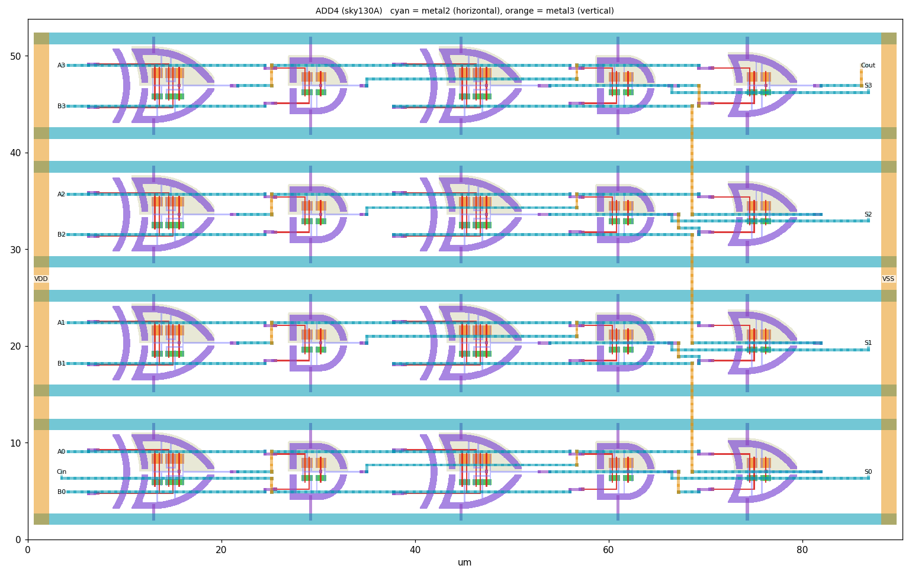
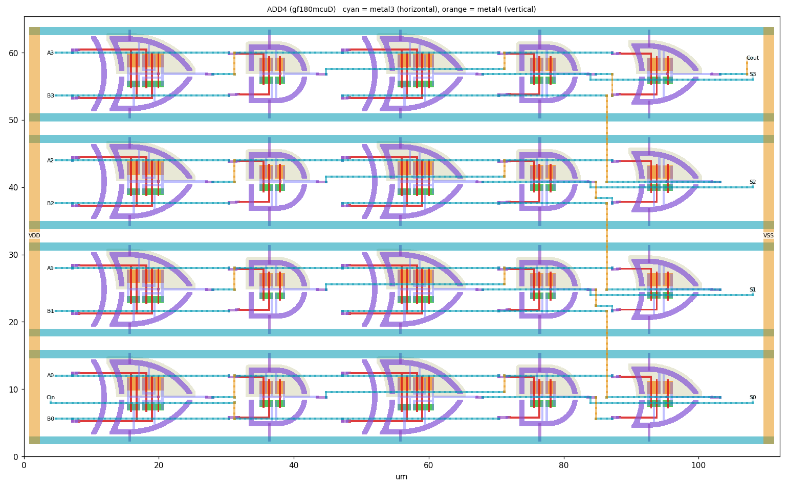

# Example: 4-bit ripple-carry adder (ADD4)
A 4-bit adder built from the EG-LOGIC symbol cells, for SKY130 and GF180MCU.

**SKY130**: 90.3 x 53.8 um


**GF180MCU**: 112.0 x 65.4 um


## Structure
Each row is one full adder, and bit 0 is the bottom row. Cells run left to right:

| Cell | Function |
|---|---|
| XOR | x = A ⊕ B |
| AND | g = A · B |
| XOR | S = x ⊕ C |
| AND | t = x · C |
| OR | Cout = g + t, the carry into the row above |

That is 20 cells (128 transistors). The top cell is hierarchical: it places the library cells
from `../../<pdk>/` with Magic `use` statements and adds only the wiring.

The library cells only use R1 and R2, so all wiring runs over them on the next two metals:

| | SKY130 | GF180MCU |
|---|---|---|
| Pin stubs (cell pin out to the routing grid) | met1 | metal2 |
| Horizontal routing, VDD/VSS rails (one pair per row) | met2 | metal3 |
| Vertical routing, VDD strap (left) and VSS strap (right) | met3 | metal4 |
| Routing pitch | 0.70 um | 0.80 um |

Signals are routed by a small two-layer maze router (A*) in `make_adder4.py`. Each cell's VDD
and VSS outline is tied to its row's rails with a short R2 stub.

Ports: `A0..A3`, `B0..B3` and `Cin` on the left edge, `S0..S3` and `Cout` on the right edge
(all on the horizontal routing layer), plus `VDD` and `VSS` on the two straps.

## Verification
| | SKY130 | GF180MCU |
|---|---|---|
| Magic DRC (`drc(full)`, whole hierarchy) | 0 errors | 0 errors |
| Netgen LVS (hierarchical, vs. `ADD4_ref.spice`) | match | match |
| ngspice, all 512 A/B/Cin vectors (extracted, with parasitic C) | 512/512 | 512/512 |
| Worst-case settle time (typical, 10 fF per output) | 1.38 ns | 1.91 ns |

The settle time is measured from an input edge to the last output crossing VDD/2. It is the
carry ripple through four AND-OR stages.

## Tiny Tapeout
The SKY130 version fits in one 1x1 Tiny Tapeout tile (about 161 x 111.5 um) and leaves room
spare. It is not yet in a Tiny Tapeout template. That still needs:
- the ports wired to the template's met4 `ui_in` / `uo_out` pins
- VDD/VSS taken to met4 power stripes
- unused outputs tied to ground

It uses no met4 or met5 today. Tiny Tapeout documents hand-made GDS only for its analog
templates (1x2 minimum), so check with them whether a digital-only custom GDS can be 1x1.

## Rebuild
```sh
export PDK_ROOT=~/pdk
../../run_all.sh        # library cells first (the preview uses their mask files)
./run.sh                # both PDKs, or: ./run.sh sky130A
```
`run.sh` runs `make_adder4.py` (layout, reference netlist, preview), Magic DRC + extraction +
GDS, netgen LVS and `sim_adder4.py`, and writes `<pdk>/summary.txt`. The Magic run takes about
a minute per PDK, and the exhaustive simulation a few more.

To open the adder in Magic, start in the `<pdk>` directory so the relative cell paths resolve:
```sh
cd sky130A
magic -rcfile $PDK_ROOT/sky130A/libs.tech/magic/sky130A.magicrc ADD4.mag
```
