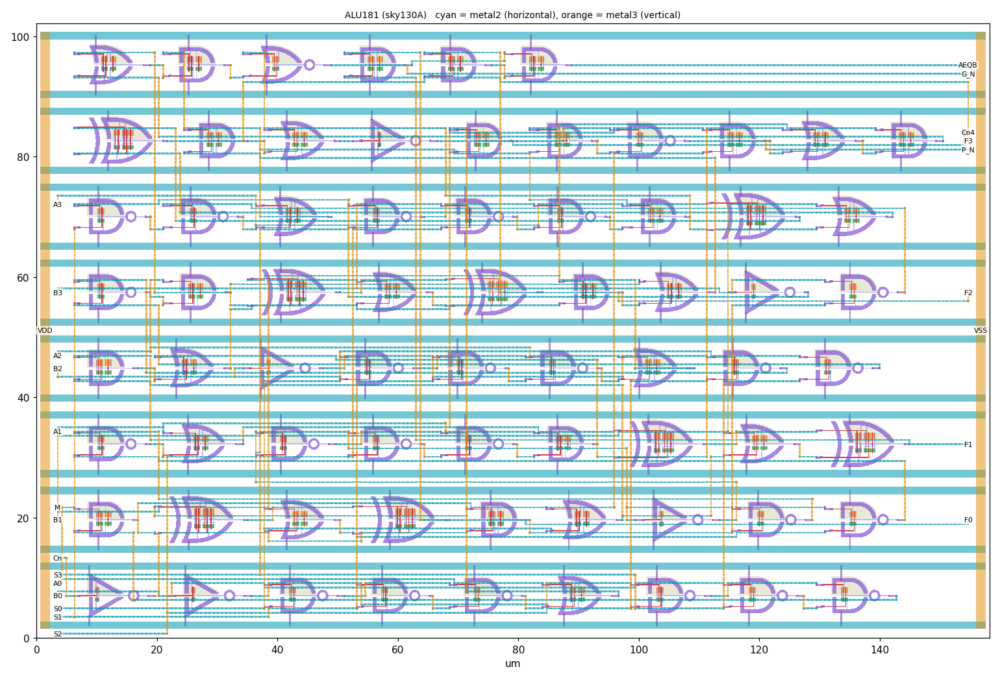
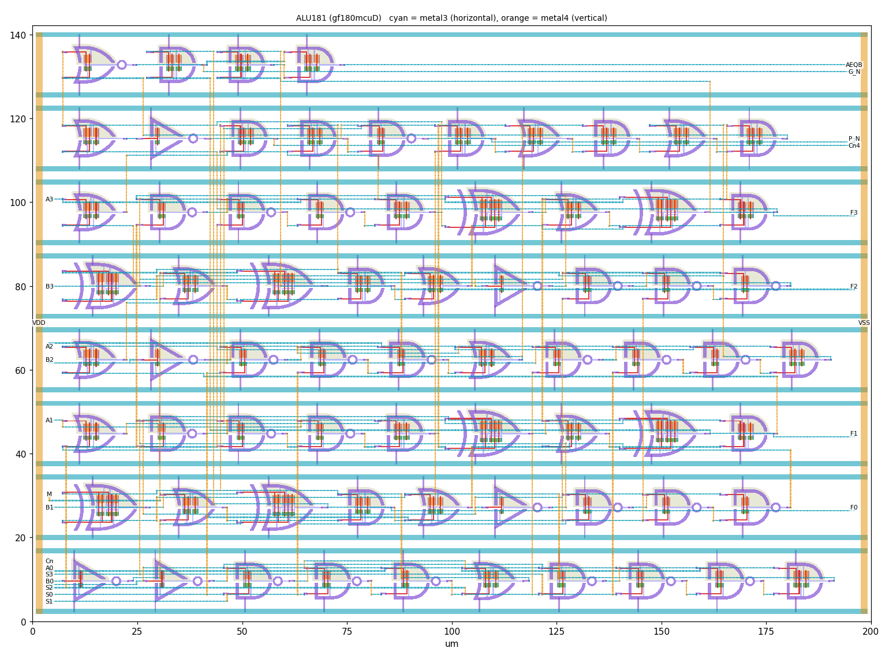

# Example: 74181 4-bit ALU (ALU181)
The 74181 arithmetic logic unit built from the EG-LOGIC symbol cells, for SKY130 and GF180MCU.

**SKY130**: 158.2 x 102.1 um (fits in one Tiny Tapeout 1x1 tile, about 161 x 111.5 um)


**GF180MCU**: 200.0 x 142.2 um


## Logic
The original 74181 schematic uses 3- to 5-input AND and AND-OR-INVERT gates. The library only
has 2-input gates, so this is the same logic function built differently, not a gate-for-gate
copy. With active-high data, for each bit i:

| Signal | Function | Cells |
|---|---|---|
| p | A + B·S0 + B̄·S1 | NOT, 3 NAND, OR |
| g | A·(B̄·S2 + B·S3) | 3 NAND, AND |
| F | (p ⊕ g) ⊕ (M + c) | XOR, OR, XOR |
| c(i+1) | g + p·c, with c0 = C̄n (ripple carry) | AND, OR |

Group outputs:

| Output | Function |
|---|---|
| Cn+4 | NOT c4 |
| P̄ | NOT (p0·p1·p2·p3) |
| Ḡ | NOT (g3 + p3·(g2 + p2·(g1 + p1·g0))) |
| A=B | F0·F1·F2·F3 (a normal output here, not open-collector) |

In arithmetic mode the chip computes F = p plus g plus carry, which covers all 16 functions
in the datasheet. M = 1 masks the carries, which gives the 16 logic functions.
The carry ripples, where the 74181 uses carry lookahead. The function is the same, but
the arithmetic critical path is longer.

That makes 70 cells: 25 NAND, 16 AND, 14 OR, 8 XOR, 6 NOT and 1 NOR, or 376 transistors.
`alu181_netlist.py` holds the netlist. It checks it against the 74181 function table on all
16,384 input combinations: F0–F3, Cn+4, A=B, and P̄/Ḡ through the identity
c4 = G + P·c0. There are 0 mismatches.

Ports, with active-high data:
- Left edge: `A0..A3`, `B0..B3`, `S0..S3`, `M`, `Cn`
- Right edge: `F0..F3`, `AEQB`, `P_N`, `G_N`, `Cn4`
- `VDD` and `VSS` on the two straps

As on the real chip, `Cn` and `Cn4` are active low (1 = no carry).

## Layout
`make_alu181.py` places the 70 cells in netlist order: Cn inverter, bit 0 to bit 3, then the
group logic. It fills rows left to right up to 150 um (SKY130) or 190 um (GF180) wide, giving
8 rows. Routing, rails and straps are the same as the [ADD4 example](../adder4/README.md):
- the cells use R1/R2 only
- signals run over them on met2/met3 (SKY130) or metal3/metal4 (GF180)
- routing uses the same A* maze router, which retries with a different net order if a net
  fails

Nothing uses met4 or met5.

## Verification
| | SKY130 | GF180MCU |
|---|---|---|
| Magic DRC (`drc(full)`, whole hierarchy) | 0 errors | 0 errors |
| Netgen LVS (hierarchical, vs. `ALU181_ref.spice`) | match | match |
| ngspice on the extracted netlist (with parasitic C), 260 vectors, all 8 outputs | 260/260 | 260/260 |
| Worst-case settle time (typical, 10 fF per output) | 2.38 ns | 2.97 ns |

The 260 vectors are every combination of S (16), M (2) and Cn (2), each with 4 random A/B
pairs, plus the longest carry ripple (A = 1111 plus B = 0000 with Cn toggling). The settle
time runs from an input edge to the last output crossing VDD/2.

## Tiny Tapeout
The SKY130 layout fits a 1x1 tile with about 3 um to spare in width and 9 um in height.
Wrapping it in a Tiny Tapeout template still needs:
- the 14 inputs and 8 outputs wired to the template's met4 pins. Tiny Tapeout has 8 `ui_in`
  inputs and 8 `uio` bidirectional pins, so 14 inputs fit (8 + 6 of the bidirectional pins)
- power taken to met4 stripes
- unused outputs tied low

That wiring needs some room, so a 1x1 tile is tight; 1x2 is comfortable. Tiny Tapeout documents
hand-made GDS only for its analog templates (1x2 minimum), so check with them first.

## Rebuild
```sh
export PDK_ROOT=~/pdk
../../run_all.sh        # library cells first (the preview uses their mask files)
./run.sh                # both PDKs, or: ./run.sh sky130A
```
`run.sh` does the following and writes `<pdk>/summary.txt`:
- checks the netlist against the 74181 function table
- builds the layout, reference netlist and preview
- runs Magic DRC, extraction and GDS output
- runs netgen LVS
- runs `sim_alu181.py`

The ngspice run takes several minutes per PDK.

To open the ALU in Magic, start in the `<pdk>` directory:
```sh
cd sky130A
magic -rcfile $PDK_ROOT/sky130A/libs.tech/magic/sky130A.magicrc ALU181.mag
```
